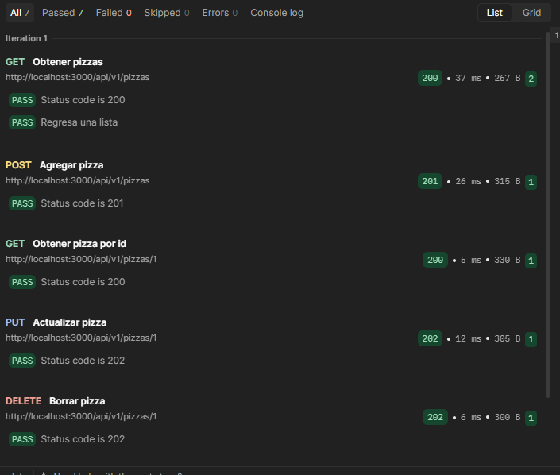
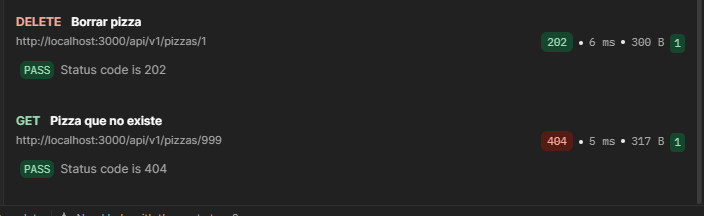

# Pizzas Mongo

CRUD de pizzas con Node.js, Express y MongoDB. Es el mismo proyecto de Pizzas V2, solo cambió el repositorio (`repositorios/pizza.repositorio.js`) para guardar en Mongo en lugar de memoria.

## Base de datos

Mongo corre en Docker:

```
docker compose up -d
```

- Cadena de conexión: `mongodb://localhost:27017`
- Base: `pizzeria`
- Colección: `pizzas`

## Ejecutar

```
npm install
npm run dev
```

## Pruebas

Colección de Postman en la carpeta `postman` (ambiente `dev`).




